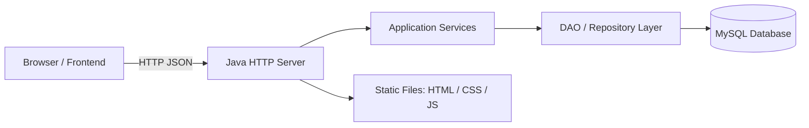
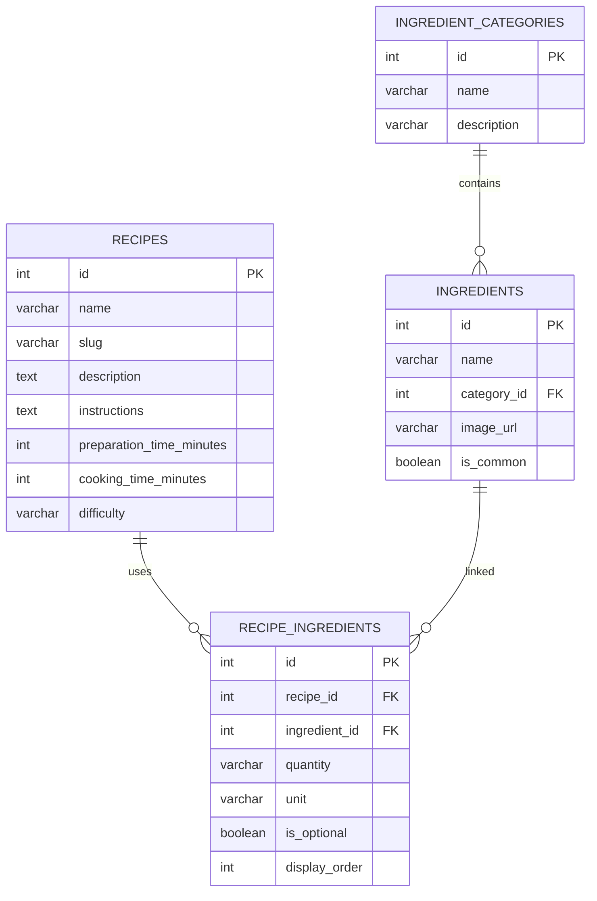

# What’sInMyKitchen

What’sInMyKitchen is a beginner-friendly recipe-finder web app that helps users discover recipes using ingredients already available in their kitchen. The project uses Java’s built-in HTTP server, JDBC, and MySQL, with a responsive frontend served from the same application.

## Project overview

The app lets users:
- search an ingredient catalogue from MySQL,
- select the ingredients they already have,
- submit a match request to the Java backend,
- view recipes ranked by how closely they match,
- see missing required ingredients,
- filter by dietary preferences and time,
- open detailed recipes,
- save favourite recipes in browser localStorage.

## Problem statement

Many people want to cook with what they already have, but do not know what recipes suit their pantry. This app solves that by comparing selected ingredients to recipe requirements and showing the closest matches.

## Objectives

- Build a full-stack Java application without Maven, Gradle, Spring Boot, Tomcat, or JSP.
- Use Java 17+ and `com.sun.net.httpserver.HttpServer`.
- Use JDBC and MySQL Connector/J to fetch recipe and ingredient data.
- Serve the frontend and API from the same origin.
- Keep the code professional, maintainable, and approachable for beginners.

## Features

- Searchable ingredient catalog
- Ingredient category filters
- Multi-select pantry matching
- Recipe scoring based on required ingredients
- Missing ingredient reporting
- Dietary, time, and difficulty filters
- Recipe detail modal with instructions and ingredient list
- Favourite recipes stored in browser localStorage
- Responsive UI for desktop, tablet, and mobile
- Health endpoint and graceful DB fallbacks

## Technology stack

- Java 17+
- JDBC + MySQL Connector/J
- MySQL 8
- HTML5
- CSS3
- Vanilla JavaScript
- Java built-in HTTP server
- Docker
- Git and GitHub

## Architecture diagram



## Database schema overview



## Recipe matching algorithm

The backend matches recipes using required ingredients only. For each recipe:

- R = required-ingredient set
- U = selected user ingredients
- M = number of required ingredients also selected
- N = total number of required ingredients

The match percentage is:

$$
\text{Match Percentage} = \left(\frac{M}{N}\right) \times 100
$$

This calculation:
- compares ingredient IDs, not names,
- counts each required ingredient only once,
- ignores optional ingredients in the denominator,
- safely handles recipes with zero required ingredients,
- returns missing required ingredients separately.

## Project directory structure

```text
whatsinmykitchen/
├── database/
│   ├── schema.sql
│   └── seed.sql
├── lib/
│   └── README.md
├── public/
│   ├── css/
│   │   └── styles.css
│   ├── js/
│   │   ├── api.js
│   │   ├── app.js
│   │   ├── favourites.js
│   │   ├── ingredients.js
│   │   ├── recipes.js
│   │   └── ui.js
│   ├── index.html
│   └── images/
├── scripts/
│   ├── build.ps1
│   └── run.ps1
├── src/
│   └── main/
│       └── java/
│           └── com/
│               └── whatsinmykitchen/
├── .dockerignore
├── .env.example
├── .gitignore
├── Dockerfile
├── README.md
└── build/
```

## Prerequisites

- Windows 11
- VS Code
- JDK 17 or newer
- MySQL 8 installed locally
- Access to MySQL Command Line or a MySQL client
- Internet access to download the MySQL Connector/J JAR

## Local setup instructions for Windows

1. Open PowerShell in the project root.
2. Verify Java is installed:
   ```powershell
   java -version
   javac -version
   ```
3. Download MySQL Connector/J from the official MySQL website and place the JAR in `lib/`.
4. Create a `.env` file by copying `.env.example` and replacing the placeholders.
5. Start MySQL locally and create the database if needed.
6. Import the schema and seed files.
7. Compile the Java app:
   ```powershell
   .\scripts\build.ps1
   ```
8. Run the app:
   ```powershell
   .\scripts\run.ps1
   ```
9. Visit `http://localhost:8080` in your browser.

## Download and configure Connector/J

The project does not use Maven or Gradle. Instead, add the MySQL driver manually.

1. Download Connector/J from the official MySQL site:
   - https://dev.mysql.com/downloads/connector/j/
2. Place the JAR in the project `lib` directory.
3. The recommended file name is:
   ```text
   lib/mysql-connector-j-8.4.0.jar
   ```
4. Build scripts expect this file name.

## Configure MySQL

Create a local database with MySQL Workbench, MySQL shell, or the command line:

```sql
CREATE DATABASE whats_in_my_kitchen;
CREATE USER 'your_user'@'localhost' IDENTIFIED BY 'your_password';
GRANT ALL PRIVILEGES ON whats_in_my_kitchen.* TO 'your_user'@'localhost';
FLUSH PRIVILEGES;
```

Then update your environment variables.

## Import schema and seed data

From the root folder:

```powershell
mysql -u root -p < database\schema.sql
mysql -u root -p < database\seed.sql
```

If you use a custom user:

```powershell
mysql -u your_user -p whats_in_my_kitchen < database\schema.sql
mysql -u your_user -p whats_in_my_kitchen < database\seed.sql
```

## Build and run without Maven

### PowerShell

```powershell
.\scripts\build.ps1
.\scripts\run.ps1
```

### Linux / Docker notes

On Linux, the classpath uses `:` instead of `;`:

```bash
javac --add-modules jdk.httpserver -cp "/app/lib/mysql-connector-j-8.4.0.jar" -d build/classes $(find src -name "*.java")
java --add-modules jdk.httpserver -cp "build/classes:/app/lib/mysql-connector-j-8.4.0.jar" com.whatsinmykitchen.Main
```

## API endpoints

- `GET /api/health` — app and database health check
- `GET /api/ingredients` — ingredient list with search, category, limit, offset
- `GET /api/categories` — ingredient category list
- `GET /api/recipes` — recipe listing with filters
- `GET /api/recipes/{id}` — recipe detail and ingredients
- `POST /api/recipes/match` — recipe matching request

## Environment variables

```env
DB_HOST=localhost
DB_PORT=3306
DB_NAME=whats_in_my_kitchen
DB_USER=root
DB_PASSWORD=your_mysql_password
DB_USE_SSL=false
PORT=8080
```

## Deployment instructions

This project is prepared for a Docker-based deployment and a separately hosted MySQL instance.

### Recommended deployment flow

1. Create a GitHub repository.
2. Push the project.
3. Provision a managed MySQL database on a provider such as Render, Railway, DigitalOcean, or another compatible host.
4. Import `database/schema.sql` and `database/seed.sql` into the cloud database.
5. Set the environment variables on the hosting provider.
6. Deploy the Docker image.
7. Verify the health endpoint and test the website.

> Use secure DB settings in production. Do not expose a public database without firewall rules or network restrictions.

## Troubleshooting

- Database connection fails: confirm credentials and `DB_HOST`/`DB_PORT` values.
- Connector/J missing: place the downloaded JAR in `lib/`.
- HTTP 404 on frontend files: make sure the project is started from the root folder.
- 503 on `/api/health`: the Java app started, but the database is unreachable.
- Build fails: check Java version and ensure you are using JDK 17+.

## Screenshots

Screenshots can be added here after the app is locally tested and hosted. No live public URL is included in this project yet.

## Future enhancements

- user account and saved favourites in the database,
- advanced recipe search,
- shopping list generation,
- nutrition and ingredient substitution suggestions,
- multilingual UI,
- AI-style recipe recommendations.

## License

This project is provided for educational and portfolio use. Add your preferred license before public deployment if required.
